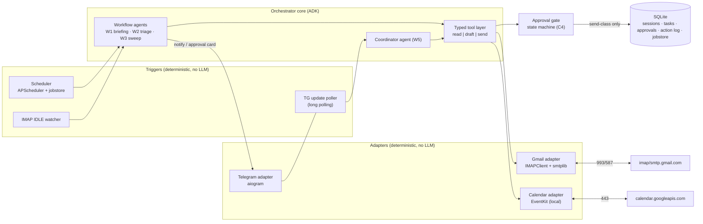

# Architecture: Gated Proactive Monolith — Day Orchestrator

Single-user agent orchestrator that organizes the owner's day. Channels: Gmail (IMAP/SMTP, user-mandated) and Telegram. Framework: Google ADK (Python). Host: the owner's Mac.

Method: Tailor-Made Architecture (capabilities → constraints → derived style). Drivers elicited from owner via structured interview, 2026-11-22.

## Business drivers → capability targets

Drivers:
- **D1** — "organize my day": briefings, email triage, task extraction, reminders/follow-ups, calendar awareness (all five selected).
- **D2** — interaction is mostly **proactive**: the agent briefs and reminds; the owner rarely types.
- **D3** — runs **on this Mac** only.
- **D4** — email autonomy is **read + draft only**; nothing sends without owner approval via Telegram.

| Capability | Target | Trace (concrete loss avoided) | Critical |
|---|---|---|---|
| Auditability | **+4** | One unapproved send destroys trust → product dead. Every send must trace to a recorded approval. | ✓ |
| Privacy | **+4** | Personal mail is the crown jewel. Local-only storage; minimized exposure to the LLM provider. | ✓ |
| Timeliness (user-perceived) | **+3** | Brief ≤ 2 min after schedule when awake; catch-up ≤ 2 min after wake; Telegram command ack ≤ 10 s. Not +4/+5: deferral during sleep is accepted by D3. | ✓ |
| Reliability | **+2.5** | Approvals/tasks/state never lost across crash or restart (zero-loss). Occasional timing misses while asleep are acceptable. | ✓ |
| Simplicity | +3.5 | One maintainer (owner + coding agent). Complexity ceiling is low; boring tech only. | |
| Extensibility | +3 | Add a channel or capability (e.g. Notion tasks, calendar writes) without core rewrite. | |
| Affordability | +3 | LLM cost ~cents/day; $0 infra (own Mac). | |
| Testability | +2.5 | Deterministic pipelines unit-testable; LLM behind swappable seams. | |
| Observability | +2 | Explain every sent email and every proactive decision from logs alone. | |
| Scalability | **−2** | Explicit anti-goal. One user. Any design pressure toward scale is a defect, not a feature. | |

At most four critical: auditability, privacy, timeliness, reliability.

## Derived style

**Gated Proactive Monolith** — extends **Modular Monolith** (single process, domain-partitioned modules, shared partitioned database), grafts the **Orchestrated Event-Driven** mediator constraint (deterministic workflow pipelines with persistent state — but in-process; the "queue" is SQLite, no broker), and adds a microkernel-flavored **uniform tool interface** between the LLM and the world.

### Constraints

1. **Single process, single machine, outbound-only networking.** Telegram via long polling, IMAP/SMTP outbound. No inbound listeners, no exposed ports, no public endpoint. → privacy (no attack surface), simplicity, affordability; enables D3 behind NAT.
2. **SQLite-only persistence, one file (WAL).** ADK sessions via `DatabaseSessionService("sqlite+aiosqlite:///...")`; app tables partitioned by module (tasks, approvals, action_log, tasks, reminders, memory, notification_budget). → simplicity, affordability, reliability (crash-safe), auditability (transactional action log).
3. **Uniform typed tool layer.** The LLM reaches the world only through tools; every tool declares an effect class: `read` | `draft` | `send` | `notify`. → auditability, safety, extensibility (channel = adapter + tool set).
4. **Approval gate as database state, not chat parsing.** `send`-class tools execute only against a **resolved approval row** (state machine: `pending → approved | rejected | cancelled`). The owner approves via Telegram inline-keyboard callbacks correlated by approval id; a pending draft can be edited before approval. Free-text "yes" never authorizes. An **at-most-once send latch** (`send:<approval_id>` claim) makes an approved row un-re-sendable, and a failed SMTP send after approval pushes an explicit failure note. → auditability, reliability, testability. This is the system's single trust boundary; there is exactly one send path.
5. **Deterministic shell, LLM core.** Triggers, scheduling, and adapters are plain Python with no LLM calls. LLM executes only inside ADK agent/workflow steps with bounded, minimized inputs. → testability, affordability, predictability.
6. **Domain-partitioned modules + typed in-process event bus.** Modules: `gmail`, `telegram`, `calendar`, `planner`, `triage`, `tasks`, `approval`, `memory`, `scheduler`, `orchestrator`. Cross-module communication via typed events on an in-process bus; adapters never call adapters; each module owns its tables. → extensibility, evolvability (a later Docker split is per-module), testability.
7. **Idempotent catch-up scheduling.** Every scheduled effect carries a dedup key (`brief-2026-11-22-morning`). Missed ticks run **once** on wake, never N times; reminders and pending approvals survive restarts. → reliability, timeliness.
8. **Secrets in the git-ignored `.env`** (macOS Keychain as fallback): Gmail credential, Telegram bot token, OAuth tokens. Never hardcoded in committed code, in the DB, logs, or prompts. → security, privacy.
9. **Content minimization at the LLM boundary.** Triage sees subject + snippet; full body only on demand or when drafting. Nothing is persisted to third-party services beyond the model provider. → privacy, affordability.
10. **Notification budget.** Proactive messages are capped per category per day (configurable). A proactive-first agent fails by nagging; silence is a feature. → timeliness includes not over-notifying.

### Runtime workflows

| ID | Workflow | Trigger | Shape |
|---|---|---|---|
| W1 | Morning briefing | Scheduler 07:00 local | Sequential: fetch overnight mail → batch triage → **persist** (`email_triage`) → task extraction → plan day (pre-rendered calendar + bucketed task lines + awaiting-reply lines) → compose brief → chunked Telegram push |
| W2 | New-mail triage | IMAP IDLE (poll fallback 3 min) | Triage → **persist** (`email_triage`, first-seen wins) → notify only above importance threshold |
| W3 | Follow-up sweep | Scheduler 2×/day (13:00, 18:00) | Read `email_triage` needs_reply (≤7 days) → drop actually-replied threads (`in_reply_to` audit) → budgeted "Awaiting your reply" push |
| W4 | Approval flow | Telegram callback | Resolve approval row → resume blocked pipeline → SMTP send / EventKit write → action log entry |
| W5 | Coordinator | Telegram free text | ADK command agent with the tool set; recommends conflict-free slots for underspecified moves; Romanian weekday mapping verified before tool calls |

### Stack

| Concern | Choice | Note |
|---|---|---|
| Runtime | Python 3.12 via `uv` (system Python is 3.9 — not usable) | |
| Framework | `google-adk` | agents, workflow agents, session service |
| Telegram | `aiogram` 3.x, long polling | no webhook → no public endpoint (C1) |
| IMAP | `IMAPClient` (IDLE support), executor thread bridged to asyncio | IDLE flaky → 3-min poll fallback |
| SMTP | stdlib `smtplib`, STARTTLS 587 | sends only via approval-gated path |
| Calendar | **Apple EventKit via `.app` bundle** (ADR-009 + addenda): full read + gated writes (create/edit/delete, recurrence, alarms, notes, invitees-in-notes, geocoded structured locations); writes target `calendar_target` (default Home) | Google Calendar API adapter kept behind `calendar_backend = "google"` (read-only) |
| Geocoding | `CLGeocoder` inside the bundle (NSApplication + run-loop pump recipe) | validates event locations, attaches coordinates (travel-time on iPhone); no TCC needed |
| Persistence | SQLite (stdlib + ADK `DatabaseSessionService`) | one file, WAL; `email_triage` = triage source of truth (ADR-010) |
| Scheduling | APScheduler (in-memory store), launchd `KeepAlive` | catch-up on wake (C7); effects re-derived per boot |
| Secrets | project `.env` (git-ignored), Keychain fallback | `app/core/secrets.py` |
| Models | config-driven (ADR-007): Gemini strings, or local OpenAI-compatible endpoint via LiteLLM — currently `ds41` on the LAN | flash-class for triage batches, stronger for planning |

### System context (C4 level 1)

| Actor / system | Interaction | Protocol |
|---|---|---|
| Owner | briefs, reminders, approvals, commands | Telegram Bot API (long polling) |
| Gmail | read mail, drafts, send | IMAP 993 TLS / SMTP 587 STARTTLS; app password or XOAUTH2 |
| Apple Calendar (local) | read events | EventKit via Calendar.app (syncs with iPhone); Google API adapter optional via config |
| LLM provider (Gemini) | agent reasoning | outbound HTTPS via ADK; minimized content (C9) |

### Container diagram (C4 level 2)

## X-factor fit

| Constraint | Prerequisite | Status | Mitigation |
|---|---|---|---|
| C1 outbound-only | Telegram bot token | To create | BotFather, 5 min |
| Gmail via IMAP/SMTP | 2-Step Verification + app password (or OAuth client in test mode) | To create | App password is the simple path; OAuth is the durable path → ADR-002 |
| IMAP limits vs Gmail API | IMAP exposes less: labels appear as folders, no server-side push beyond IDLE | Accepted (D1 user-mandated transport) | Drafts via APPEND to `[Gmail]/Drafts` (visible in Gmail UI); IDLE + poll fallback |
| Scheduling on a Mac | Mac awake at trigger times | Partially met | C7 catch-up; launchd `KeepAlive`; lid-closed sleep means deferred briefs — accepted by D3 |
| ADK Python ≥3.10 | Python 3.12 venv via `uv` | `uv` present, system Python 3.9 | `uv python install 3.12`; project venv |
| Single maintainer | Boring-stack discipline holds | OK | Constraints enforced by CI gates (below) |

## Trade-off summary

| Capability | Gain from this style | Cost | Verdict |
|---|---|---|---|
| Auditability +4 | Single send path + approval state machine + append-only action log in SQLite | Every send adds a confirmation round-trip for the owner | Accepted — that friction is the product (D4) |
| Privacy +4 | Local-only storage; minimized LLM payloads; no inbound surface | Mail content still transits the model provider | Accepted with C9 minimization; local-model swap is a cheap future move |
| Timeliness +3 | IDLE/poll + catch-up scheduler | Mac asleep = deferred delivery | Accepted by D3; evolution trigger below |
| Reliability +2.5 | WAL SQLite survives crashes; idempotent catch-up prevents double-sends | No redundancy — host failure halts the assistant | Accepted; state is one copyable file |
| Simplicity +3.5 | One process, one file, no broker, no k8s | Modules share one failure domain | Accepted |
| Extensibility +3 | Adapter+tool contract; events over direct calls | Event indirection adds a seam to learn | Worth it |
| Affordability +3 | Flash-class models for batch triage; no infra cost | Stronger planner model costs more per brief | Bounded by daily budget config |
| Testability +2.5 | Deterministic pipelines; LLM behind seams; approval machine unit-testable | Tool/event plumbing needs integration tests | Accepted |
| Observability +2 | Action log + structured logs + ADK traces | In-process events are harder to trace than a broker | Logs written at event boundaries compensate |
| Scalability −2 | Deliberately none | None — this is the point | Guardrail against overengineering |

## Anti-style risks

| Missing/violated constraint | Resulting anti-style |
|---|---|
| C5 leaks (LLM in adapters) | Smart-adapter mud — untestable, unpredictable |
| C4 replaced by chat-text parsing | Audit hole: unattributable sends |
| C2 bypassed (JSON side files) | Persistence fragmentation; state loss on restart |
| C7 dropped | Double-send / double-brief after wake — trust destroyed |
| C6 bypassed (adapter→adapter calls) | Untestable spaghetti; future Docker split impossible |
| C10 dropped | Nagging → owner mutes the bot → proactive channel dead |
| Two decision centers (scheduler *and* agent deciding independently) | Conflicting pushes; scheduler owns timing, agents own content |

## Evolution path (ordered by constraint cost)

1. **Move to an always-on box (Docker on home server / VPS)** — trigger: missed brief > 1/week from sleep. Cheap: single process already container-izable; SQLite rides as a volume; long polling needs no ports. Deployment-level change first — cheapest class.
2. ~~**Local model option (Ollama / LM Studio, OpenAI-compatible)**~~ — **DONE 2026-11-22 (ADR-007)**: live on `ds41` at `192.168.0.206:8000/v1`; content minimization (C9) already bounded exposure; nightly evals (03:30) watch for drift.
3. **Gmail API adapter** — trigger: need server-side labels/push/quota headroom. Swap behind the unchanged tool interface (C3); medium cost.
4. ~~**Calendar write access**~~ **Delivered (ADR-009 addenda)**: full CRUD behind the gate — `add_calendar_event` (notes, invitees-in-notes, alarms, recurrence, geocoded `structuredLocation`), `edit_calendar_event` (single occurrence), `delete_calendar_event` (event + future); geocoding via Apple `CLGeocoder` in the bundle. Google-backend writes remain open.
5. **Never unless real**: multi-user, horizontal scale, microservice split (−2 target stands).
6. **ADK `SequentialAgent` → `Workflow` API migration** — ADK deprecation warning (2026-11-22): SequentialAgent will be removed in a future version; `Workflow` cannot yet be used as an `LlmAgent` sub-agent, so migrate only when ADK reaches parity. Cheap swap behind unchanged pipelines.

## Documentation & enforcement

**ADRs** (all written — see `day-orchestrator/docs/adr/`):
- ADR-001 — Derived style: Gated Proactive Monolith (this document's constraint set).
- ADR-002 — Email transport IMAP/SMTP; app-password auth first, XOAUTH2 behind the client interface.
- ADR-003 — ADK Python + `DatabaseSessionService` on SQLite (amended: `sqlite+aiosqlite`, `google-adk[db]`, model resolution).
- ADR-004 — Approval gate: DB state machine + Telegram inline keyboard, never free-text authorization (amended: send latch, send-failure signal).
- ADR-005 — Scheduling: APScheduler in-memory store, effects re-derived per boot, idempotent catch-up (amended: jobstore dropped, seconds not timedelta, instance lock).
- ADR-006 — Telegram long polling (no webhook) as the only user channel (amended: HTML + chunking, owner-chat ownership, typing, visible failures).
- ADR-007 — Model serving: config-driven Gemini strings or local OpenAI-compatible endpoint via LiteLLM; instruction-driven JSON (no `response_format`); datetime injection; nightly drift evals.
- ADR-008 — Credentials: git-ignored `.env` is canonical, Keychain fallback; no hardcoded credentials, ever.
- ADR-009 — Calendar source: Apple EventKit inside `DayOrchestrator.app` (no OAuth; TCC attributed to the bundle). Addenda: gated writes (create/edit/delete, recurrence, alarms, notes, invitees-in-notes), geocoded structured locations, `calendar_target`.
- ADR-010 — Persistent triage: `email_triage` table is the source of truth (first-seen wins); the follow-up sweep and the brief's awaiting-reply section consume it; `last_triage` memory retired.

**Enforcement gates (CI)**:
- `import-linter` layer contract: `adapters → tools → agents → events`; channel adapters never import each other; only calendar adapters may import EventKit/Google API clients.
- Gated tools (email + calendar effects) pause via ADK resumability and act only on `approval.require_resolved(...)` approved rows behind an at-most-once latch — proven by `tests/integration/test_approval_flow.py` and `tests/unit/test_send_path.py`.

## Non-goals

Multi-user, horizontal scaling, team/sharing features, multi-account Gmail (config-level future change, not architectural).
