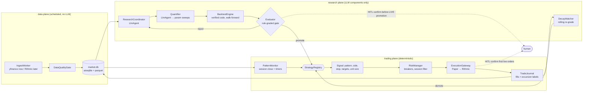

# pattern-engine — Raschke-hinted trading agent system on Google ADK

**Status: DESIGN (Phase 0 spec — code scaffold awaits approval)**

Design transcribes Linda Raschke's stated architecture (Titans of Tomorrow,
2026-11-10) into an ADK 2.x system. Golden rule from the interview:

> "It's not going to work with the LLMs… throw ChatGPT and Claude out the
> window. You can use parts of them for a component, but now you're stringing
> several different pieces together." — 1:15:18

Consequence: **two planes**. The trading decision path is 100% deterministic
code (her "money-management algorithms"); LLMs appear only in the research
loop as grunt-work components. No LLM ever prices, sizes, or exits a trade.

## Hint → component traceability

| Interview hint (timestamp) | Component |
|---|---|
| "agent that can work a particular pattern for me" (0:26:15) | `StrategyRunner` — one registered strategy = one pattern worker; pattern logic is code, not prompts |
| "worthless if you don't have money-management algorithms" (0:26:32) | `RiskManager` — exits/sizing/trailing live here, deterministic |
| "might depend on the quality of your data" (0:26:23) | `DataQualityGate` — no train/backtest/decision runs on data that fails checks |
| "statistical measurement of how much it should not go beyond this point if it's going to be a good trade" (1:09:27) | `ExcursionLabeler` — MAE/MFE-based good-trade labels |
| "regenerative learning… correct and teach itself" (1:15:55) | `ResearchLoop` (LoopAgent): propose → backtest → rule-grade → promote/demote |
| "constantly coming up with new strategies… alpha can decay in a day" (1:17:34, 0:20:12) | `DecayWatcher` — live strategies re-graded on rolling window; auto-demote |
| "be grateful for algos… liquidity" + opportunistic waiting (0:20:35) | scheduled/session-close monitoring; no chat loop needed |
| "Rhythmic's a great API" (1:17:59) | `ExecutionGateway` interface: `PaperGateway` now, `RithmicGateway` when creds exist |
| assistant executes, she never pulls triggers (0:45:06) | execution is a queue worker with confirmation gates, never interactive |
| "even bet size… unit per $100k" (0:43:51) | `PositionSizer`: risk-normalized units (ATR × tick value) |
| discretionary drawdown → cut size; system drawdown → don't (0:48:36) | two circuit breakers: process-degradation (cuts) vs expectancy-drawdown (holds) |
| skip lunchtime / news catalysts (1:09:00) | `SessionFilter` — time-of-day + calendar blackout |

## Architecture



## ADK component specs

### Trading plane

**`PatternMonitor`** — custom `BaseAgent` (like day-orchestrator's workflow
agents). Driven by the scheduler (APScheduler re-derivation at boot — no
jobstore, per ADR-004 lesson) and session-close events. For each `live`
strategy in the registry it calls the strategy's pure function
`signal(ctx) -> Signal | None`. Zero LLM calls.

**Strategy = code object** (seed: this session's verified backtest):

```python
@dataclass
class Strategy:
    id: str                      # "pullback_resumption_long_v1"
    market: str                  # "SPY"
    timeframe: str               # "1d"
    signal: Callable[[MarketCtx], Signal | None]   # pure, no LLM
    exits: ExitPolicy            # stop_dist, target_mult, trail, time_stop
    status: Literal["candidate", "live", "retired"]
    stats: RegistryStats         # PF, avgR, maxDD, n, last_graded_at
```

Seed strategies from the verified backtest: `pullback_resumption_long_v1`
(ADX>30, 20EMA pullback, resumption; 1-ATR stop, 3-ATR target, 10-bar time
stop; long-only — PF 1.46, avgR +0.31, maxDD −6.5%) and the trail variant
(PF 1.54).

**`RiskManager`** — code-only. Sizing: `units = equity_per_unit_usd / (atr ×
dollar_per_point)` (her quarterly unit recalculation → recompute on the first
session of each quarter, cached in state). Circuit breakers:
- *process degradation*: data-quality failure, missed monitor runs > 2, fill
  anomalies → halve size, page human (her: "something is wrong; cut back").
- *expectancy drawdown*: system's normal losing streak within binomial bounds
  (Lean-proven: even p=0.4 needs only p>0.25) → keep trading, no change
  (her: "that's when it's ready to spring").

**`ExecutionGateway`** — abstract. `PaperGateway` fills against next-session
data with the same conservative rules as the backtest (stop-first on
conflict bars, gap-through fills at open). `RithmicGateway` implemented only
when credentials exist; behind the same interface. First N live orders and
every promotion-to-live require `tool_context.request_confirmation` /
workflow pause (durable HITL per long-horizon-harness recipe).

### Research plane (the "regenerative loop")

`LoopAgent(name="research_loop", sub_agents=[researcher, quantifier,
evaluator], max_iterations=K)` — evaluator is a rule-graded `BaseAgent`
(escalate on pass/fail thresholds — the day-orchestrator EscalationChecker
pattern; memory lesson: rule-graded beats LLM-judge).

- **ResearchCoordinator** (`LlmAgent`, `resolve_model` from config — Gemini
  string or LiteLLM/ds41): reads registry stats + journal; proposes ONE
  concrete variant per iteration (parameter perturbation, new market, new
  pattern family) as instruction-driven JSON (no `output_schema` on local
  engines — ds41 rejects response_format).
- **Quantifier** (`LlmAgent`): converts the proposal into a sweep spec; the
  actual backtest runs in the verified engine tool (reusing
  `raschke-strategy/strategy.py` logic, moved into `core/backtest.py`).
  Walk-forward: split history into K folds; require positive avgR on every
  fold's OOS segment.
- **Evaluator** (code): promote iff `PF ≥ 1.25 ∧ avgR ≥ 0.10 ∧ maxDD ≤ 15% ∧
  n ≥ 30 ∧ OOS_degradation ≤ 50% ∧ long-only-or-justified`. LLM (if
  configured) writes the human rationale only — never grades.
- **DecayWatcher**: nightly rolling 130-trade re-grade of live strategies;
  `avgR_fold < 0` two consecutive folds → demote to retired, notify. ("an
  alpha can decay in a day")

### Data plane

`IngestWorker` (scheduler): EOD pull (yfinance free now; Rithmic market data
later) → `DataQualityGate`: monotone timestamps, no duplicate bars, OHLC
invariants (H ≥ max(O,C), L ≤ min(O,C)), gap calendar check, volume > 0 on
regular sessions. Failure → flag data, trip process breaker. "Nice clean
database" is a gate, not an aspiration.

**`ExcursionLabeler`**: for every historical signal, MAE/MFE distributions →
per-strategy `good_trade_bound` (adverse excursion a valid trade shouldn't
exceed). Feeds Evaluator features and TradeJournal labels.

### Persistence & sessions

- `DatabaseSessionService("sqlite+aiosqlite:///…/pattern_engine.db")`
  (google-adk[db]; async driver mandatory).
- `market.db`: bars, quality_flags. `registry.db`: strategies, stats,
  promotions. `journal.db`: fills, excursions, labels.
- State keys: `registry_snapshot`, `open_positions`, `quarterly_units`,
  `breakers`.

### Layering (import-linter, contract tested)

`core` (config, models, db, math, backtest) ← `strategies` ← `exec` (gateway,
risk) ← `research` (LLM agents) ← `app` (monitor workflows, runner, server).
Never a package and its parent in one layer (ADR-007 lesson).

## What is deliberately NOT here

- No LLM sentiment/news agent, no chat-driven trading (her explicit rule).
- No optimization theater: thresholds fixed ex-ante in the Evaluator; parameter
  sweeps are bounded and reported in full, winners chosen by the published
  gate only.
- No live money without credentials + human confirmation gates.

## Testing & verification plan

1. Unit: pattern functions on synthetic bars (known-geometry fixtures).
2. Contract: layer imports; gateway interface parity paper vs rithmic stub.
3. Replay: PaperGateway vs BacktestEngine on identical history — fills must
   match the verified engine exactly (regression lock on the 61-trade
   long-only B variant: PF 1.46).
4. Research loop: scripted-LLM tests (ScriptedLlm pattern from
  day-orchestrator app/smoke.py) — proposal JSON parsing, gate decisions.
5. HITL: confirmation pause/resume round-trip with re-entrant tools
   (function_call_id latch, per ADK lesson).

## Recipes to study before implementing (Phase 1)

- `long-horizon-harness` — durable HITL, scheduler/routines, guard chains
- `ambient-expense-agent` — event-driven, rules-in-code, LLM-only-on-escalation
- `deep-search` — LoopAgent + EscalationChecker reference shape

## Phase plan (post-approval)

| Phase | Delivers | Verification |
|---|---|---|
| 1 | scaffold, core (db/backtest/labels), seed strategies, replay lock | pytest: engine parity |
| 2 | PatternMonitor + RiskManager + PaperGateway, scheduler | paper trades = engine fills |
| 3 | research loop (scripted LLM tests first, ds41/Gemini second) | promote/demote on fixtures |
| 4 | DecayWatcher, journal, reports | rolling re-grade fixture |
| 5 | RithmicGateway + HITL live gates (creds required) | certification run, human sign-off |
